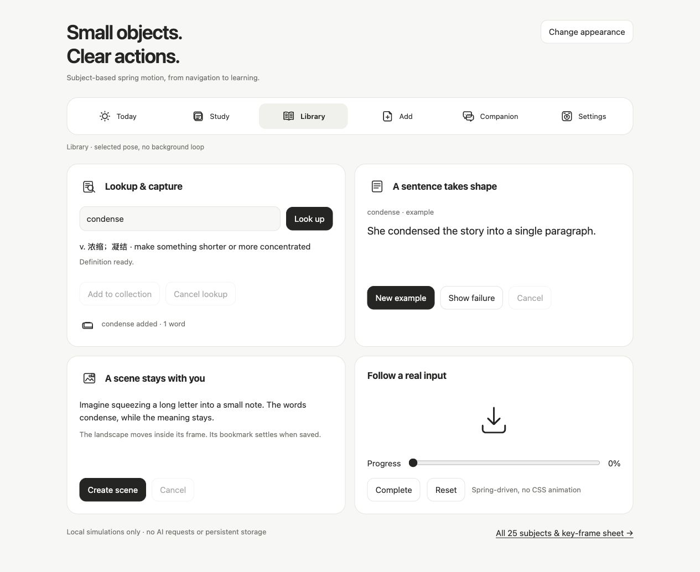

# apple-motion-icons

Apple-inspired SVG motion icons with spring physics and a vocabulary for each
object. A Codex / Cursor skill and a dependency-free browser library.

**[Live gallery →](https://skills.yhazrin.xyz/motion-icons/)** — play every icon action, search by use, change size and appearance. The gallery follows the public `main` branch; published changes are checked about every five minutes.

**87 subjects:** 13 general-purpose icons, 14 learning, capture and navigation
icons, and 60 catalog icons (system, status, files, communication, security and
AI). Hover, selection, lookup, card insertion, recall, page-turning, writing and
scene binding have their own movements. Motion stops when the object is at rest.



## Use the skill

Clone this repository as `apple-motion-icons` into your agent's skill directory:

```sh
git clone https://github.com/Yhazrin/apple-motion-icons.git ~/.codex/skills/apple-motion-icons
# For Cursor, use ~/.cursor/skills/apple-motion-icons instead.
```

If the directory already exists, update or back it up before cloning. Ask your
agent to use `$apple-motion-icons` to implement the interaction you need.

## Use the library

```html
<script src="assets/motion-icons.js"></script>
<script src="assets/motion-icons-recipes.js"></script>
<script src="assets/motion-icons-learning.js"></script>
<script src="assets/motion-icons-catalog.js"></script>
<div id="word-receipt" aria-hidden="true"></div>
<script>
  const receipt = MotionIcon.create(document.querySelector('#word-receipt'),
    'lexicon', {size: 28, pose: 'empty'});
  // Trigger this after your actual storage operation succeeds:
  receipt.play('save');
</script>
```

Colour inherits `currentColor`. Use a semantic button and a native/text label;
the icon supplies motion rather than replacing controls.

## Explore examples

```sh
python3 -m http.server 8080 --bind 127.0.0.1
```

- `http://127.0.0.1:8080/assets/gallery.html` — all poses, verbs, loops and drives.
- `http://127.0.0.1:8080/examples/workflows.html` — navigation, cancellable lookup,
  capture, generated sentence/scene feedback and driven progress with local fixtures.
- `http://127.0.0.1:8080/assets/gallery.html?frames` — deterministic 120 Hz key-frame
  sheet, exact-rest/pose/error checks; no package dependencies or build step.
- [Native SwiftUI adapter](examples/MotionIconView.swift) — transparent, decorative
  WKWebViews, native focus/accessibility, lifecycle cleanup and event replay.
- [Learning vocabulary](reference/learning.md) — the 14 added subjects and their verbs.
- [Catalog vocabulary](reference/catalog.md) — the 60 catalog subjects and their verbs.
- [Recipe authoring](reference/authoring.md) — extension rules and spring choices.

The runtime retains its 480 Hz spring integration, display-refresh rendering,
run-token cancellation, optical stroke weight and reduced-motion support.
Add new subjects in a recipe file; do not fork the animator for a new icon.

## Maintain the collection

[Publishing and maintenance](docs/MAINTENANCE.md) covers the source-of-truth rules,
static deployment, version checks, adding subjects and rollback.
[Cursor maintenance prompt](docs/CURSOR_PROMPT.md) is ready to paste into an agent.
Recipe changes become gallery cards automatically; declare a subject’s catalogue
label and actual product usage before publishing.

## Catalog refinement

The catalog uses quieter press feedback and object-specific travel. Plug/port
contact, inserted-key rotation, attached shield marks, connected thinking nodes,
clipped browser content, forward paper feed, filter particles, line-by-line
reading, bracket repair, task handoff, staggered generation and persistent queue
states are described in [the catalog vocabulary](reference/catalog.md).

The existing frame checker reports **482 checks passed** for this revision. This
checks numerical state and rest; visual review remains a separate design judgment.
The engine and 13 original recipes remain byte-for-byte unchanged.


### Restrained motion recipes

The gallery now loads `assets/motion-icons-refinements.js` last. It gives all 87
subjects quieter, component-specific motions while preserving the engine and
upstream recipe hashes. Copy this asset when embedding the full collection.
See [refinement notes](reference/refinements.md) and the preserved
[baseline plan](review/improvement-plan.md). Frame checks establish rest and pose
correctness; they do not replace judging the motion at actual icon sizes.

### Colour and review delivery

Connected Bluetooth/Wi-Fi, charging/low battery and saved favourites now carry
semantic colour alongside distinct geometry. Most subjects stay planar; inserted
paper and stacked cards have true transparent occlusion. See the authoring rules
in [SKILL.md](SKILL.md#semantic-colour-foreground-and-background).

On the [gallery](https://skills.yhazrin.xyz/motion-icons/), click **导出审阅 ZIP**
to download all action sequences as PNGs, with 10 sequences per overview sheet
and 10 separate images per folder. The package includes labels, timestamps and
a manifest. Export is local to the browser and follows the selected theme.

### Semantic quality pass

Load `assets/motion-icons-semantics.js` last (six runtime files in total). It
redraws ambiguous subjects and preserves business outcomes: loaded cart, matched
code, torn receipt and generated object. See [the changed contracts](reference/semantics.md).
Internal tap/press feedback remains callable but is omitted from main gallery
controls and default ZIP; use `gallery.html?feedback=1` to include it.
